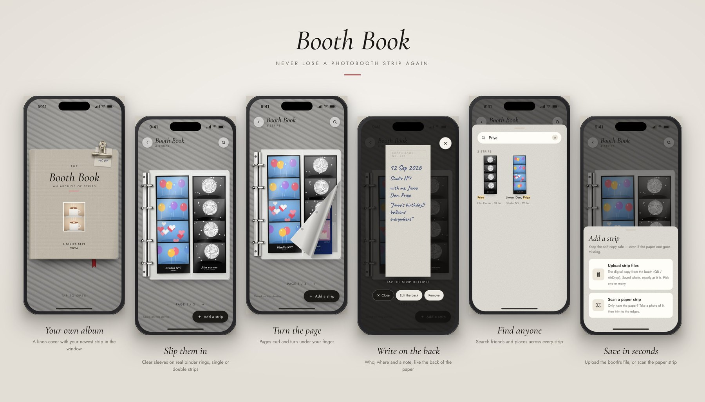
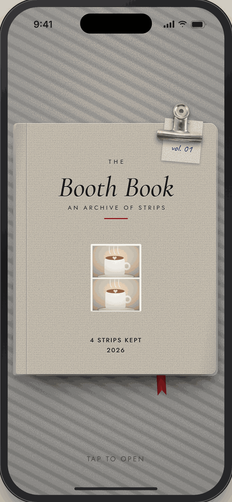
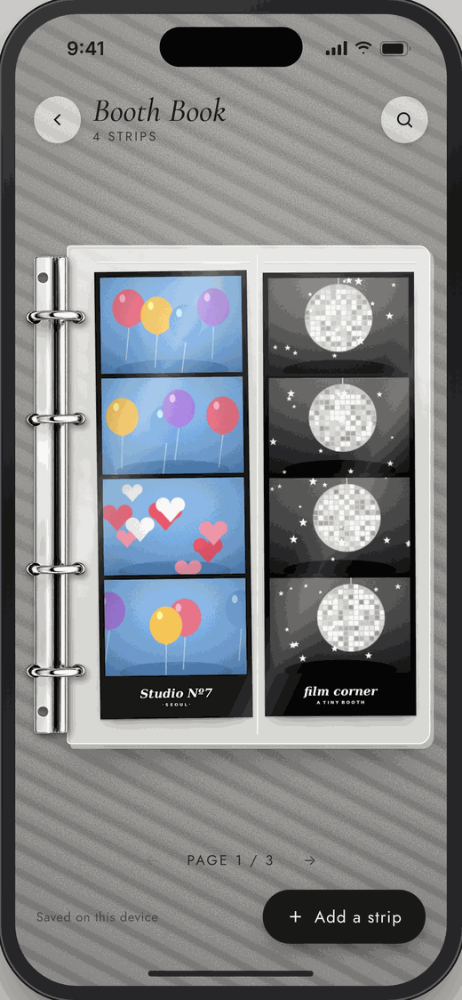
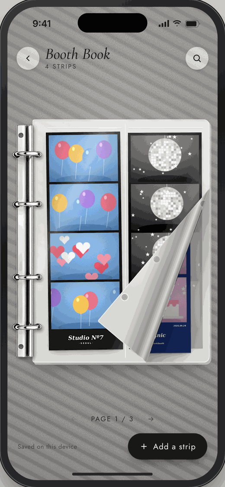
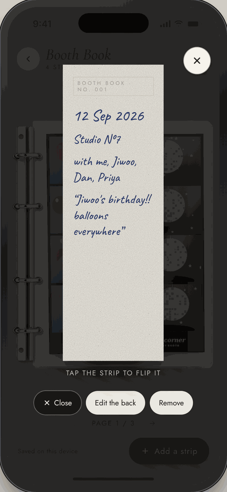
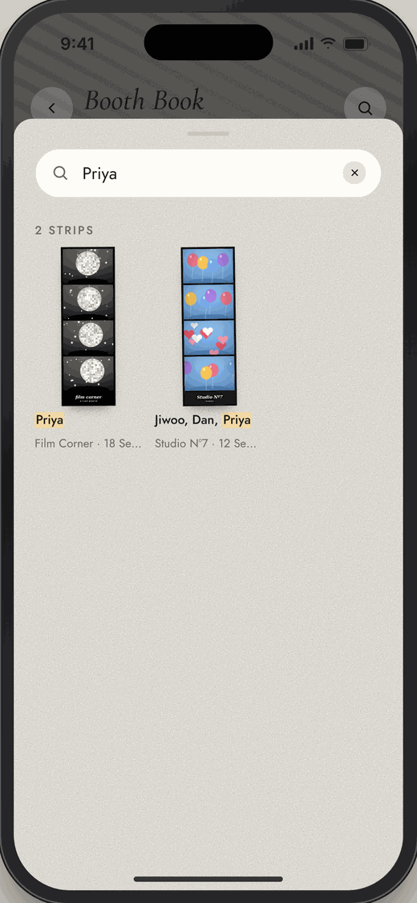
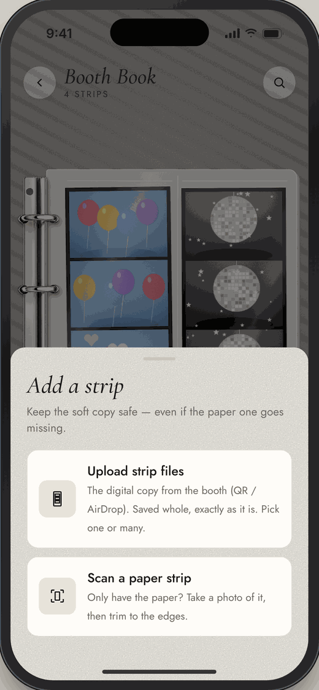

# Booth Book

**Never lose a photobooth strip again.**

Booth Book is a digital album for your photobooth strips. Save the soft copy of every strip, and keep them in an album that looks and feels like a real one: a linen cover, clear plastic sleeves on metal binder rings, and pages that curl when you turn them.



## My story

I love taking photobooth pictures. Almost every outing with friends ends in a booth. But I always end up losing the strips. They get bent in a bag, left in a jacket pocket, or forgotten in a drawer. The digital copy from the QR code gets buried in my camera roll between screenshots and never gets looked at again.

The paper strip is the part that feels special, and it's also the part that disappears. So I wanted to make something that keeps the feeling of a real album, flipping through pages and reading notes on the back, but can't be lost.

## What it does

| | |
|---|---|
|  | **Your own album**<br>The book opens from a linen cover with your newest strip in the window, a bulldog clip and a ribbon bookmark. |
|  | **Slip them in**<br>Strips sit in clear sleeves on real binder rings. Single strips go two to a page, and double strips get a full-page sleeve. |
|  | **Turn the page**<br>Drag a corner and the page curls under your finger, or swipe and tap the arrows. |
|  | **Write on the back**<br>Add the date, place, who was there and a note. Tap a strip to flip it over and read it, like the back of the paper. |
|  | **Find anyone**<br>Search by a friend's name, a place, a word from your note or a month. |
|  | **Save in seconds**<br>Upload the booth's digital file exactly as it is (one or many at once), or take a photo of a paper strip and trim it to the edges. |

It also has filters (Original, Classic B&W, Warm film, Faded, Cool night and Vivid) that never change your original file, plus a **Save to phone** button for every strip.

## My plan

**1. Prototype (now)**
- ✅ A working app that I use for my own strips
- ✅ Realistic album design, page turning, search and filters
- ⏳ Testing with friends and collecting feedback

**2. Make it a real app**
- Accounts and cloud sync, so your album is on every device and never lost
- Install to your phone's home screen
- A live booth mode: take a 4-frame strip with your phone camera and a 3-2-1 countdown
- Shared albums, so friends who were in the same booth can all keep the strip

**3. Grow it**
- Launch on the App Store and Google Play
- Partner with photobooth studios, so a QR code at the booth saves the strip straight into Booth Book
- Printed keepsake albums of your favourite strips

## Try it

It's a static web app with no build step.

- **Locally:** download the repo and open `index.html` in a browser.
- **Online:** turn on GitHub Pages under *Settings → Pages* (branch `main`, folder `/ (root)`).

For now, strips are saved in the browser you use, so clearing your browser data deletes them. Cloud sync is part of step 2 of the plan.

## Built with

- HTML, CSS and JavaScript, with no framework
- [StPageFlip](https://github.com/Nodlik/StPageFlip) by Nodlik for page turning (MIT License, see `lib/LICENSE-page-flip.txt`)
- Cormorant Garamond, Jost and Caveat fonts from Google Fonts

```
index.html                  the whole app
img/                        binder rings and bulldog clip
lib/page-flip.browser.js    page-turning engine
docs/screenshots/           images for this README
```

---

Made by Sion ([@sionyi-git](https://github.com/sionyi-git)).
